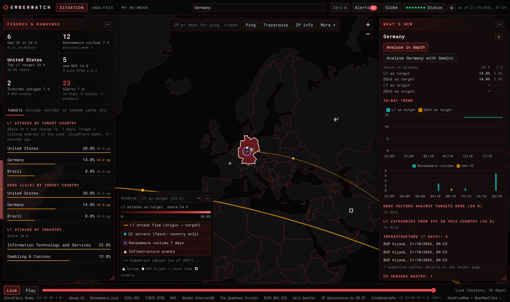
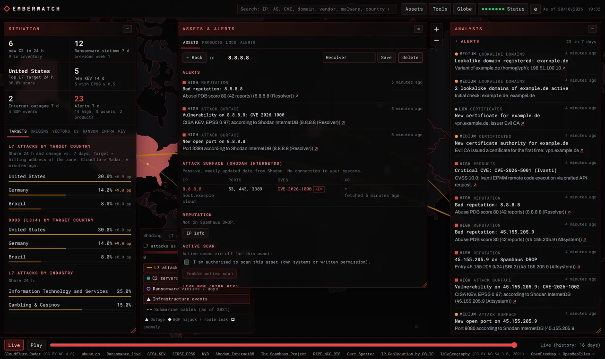

# Emberwatch

Selbst gehostetes Cyber-Lagebild auf einer Weltkarte: Angriffe, C2-Server, Ransomware, ausgenutzte Schwachstellen und Internet-Infrastruktur aus öffentlichen Quellen, dazu Überwachung eigener Assets, Produkte und Logs.

[English](README.md) · **Deutsch**



*Die Screenshots zeigen synthetische Demodaten.*

## Funktionen

**Globales Lagebild**
- Weltkarte mit L7-Angriffsflüssen (Ursprung → Ziel), Länderflächen nach Angriffsanteil, gemeldeten C2-Servern, Ransomware-Opfern je Land, Internet-Ausfällen, BGP-Hijacks/Route-Leaks, Traffic-Anomalien und Seekabeln
- Ranglisten: Ziel- und Ursprungsländer (24 h gegenüber 7 Tagen), DDoS-Vektoren, L7-Angriffskategorien, C2-Familien und Hosting-Netze, Ransomware-Gruppen und Branchen, neu ausgenutzte Schwachstellen (CISA KEV mit FIRST EPSS)
- Regelbasierte Mustererkennung (steigende Länder und Vektoren, Spikes, neue C2-Familien, KEV-Häufungen, kritische Ausfälle, Korrelationen), deterministisch und nachvollziehbar
- Zeitachse mit Tageshistorie (bis 90 Tage) und 30-Tage-Trends je Land
- Export einer C2-Blockliste (TXT/CSV) mit Filtern
- Optionale Gemini-Berichte (global, Land, Heimatregion, freie Fragen mit Rückfragen), exportierbar als Markdown oder PDF. Das Modell erhält nur aggregierte Kennzahlen.

**Eigene Assets** (IPs, Netze, AS-Nummern, Domains)
- Abgleich mit C2-Servern, ThreatFox-IOCs, BGP-Hijacks/-Leaks, Ausfällen, Ransomware-Leak-Sites, Spamhaus DROP und AbuseIPDB
- Passive Angriffsfläche über Shodan InternetDB: offene Ports, CVEs (markiert, wenn in CISA KEV), Änderungen werden zu Alarmen
- Optionaler aktiver TCP-Scan für Assets, die du ausdrücklich freigegeben und bestätigt hast: offene Ports, TLS-Zertifikate (Ablauf, Wechsel), HTTP-Server, Dienst-Banner
- Überwachung der Zertifikats-Transparenz (neue Namen und neue Zertifizierungsstellen) und Erkennung ähnlicher Domains (Tippfehler, Homoglyphen, IDN, Bitflips, andere TLDs)
- Live-BGP-Überwachung eigener Präfixe über RIPE RIS Live: unerwarteter Origin-AS, spezifischere Ankündigungen, massenhafte Rückzüge

**Produktbeobachtung:** nach einem Hersteller oder Produkt suchen (z. B. „Sophos“) und beobachten. Alarm bei neuen CISA-KEV-Einträgen und neuen kritischen CVEs aus der NVD.

**Log-Analyse:** Firewall-, Proxy-, DNS-, Web- oder Mailserver-Logs hochladen (Text oder .gz). Enthaltene IPs, Domains und URLs werden gegen C2-Server, ThreatFox-IOCs, Tor-Exit-Nodes und Spamhaus DROP geprüft. Die Datei wird nicht gespeichert. Optional fortlaufender Syslog-Empfang (UDP/TCP).

**Alarme:** ein gemeinsamer Alarm-Feed für alles, was dich betrifft, optional mit Matrix-Benachrichtigung und Tagesbericht.

**Netzwerk-Tools** mit Live-Anzeige auf der Karte: Ping, Traceroute, DNS (mit SPF/DMARC/DNSSEC-Flag), Whois (RDAP), IP-Info mit Reputation, Port-Check, HTTP/TLS-Prüfung.

**Oberfläche:** Deutsch und Englisch, verschiebbare und skalierbare Fenster mit einstellbarer Deckkraft, Tastenkürzel, Start-Animation, optionale Anmeldung.



## Voraussetzungen

- Docker mit Docker Compose oder Portainer
- Ein Volume für `/data` (SQLite-Datenbank, Anmeldedateien, DB-IP-Geodatenbanken). Die Compose-Dateien begrenzen den Speicher auf 1 GB.
- Ausgehendes HTTPS zu den Datenquellen (siehe [Datenquellen](#datenquellen-und-lizenzen)), ausgehendes ICMP/UDP für Ping und Traceroute
- Kostenlose API-Keys für die Kernquellen: Cloudflare (Radar) und abuse.ch. Alles andere ist optional.

## Installation

### Variante A: Portainer mit fertigem Image

1. *Stacks → Add stack → Web editor*, [`portainer-stack.yml`](portainer-stack.yml) einfügen.
2. Unter *Environment variables* mindestens setzen:
   - `PROXY_NETWORK` – das Docker-Netzwerk deines Reverse Proxys (Traefik, Nginx Proxy Manager, Pangolin/Newt, …)
   - `CF_API_TOKEN`, `ABUSECH_AUTH_KEY`
   - optional `LANGUAGE=de`, `AUTH_PASSWORD` und weitere Keys (alle Variablen: [`.env.example`](.env.example))
3. Deployen und im Reverse Proxy auf `http://emberwatch:8000` weiterleiten.

Das Image wird als `ghcr.io/saturdaynetlab/emberwatch` für `linux/amd64` und `linux/arm64` veröffentlicht.

### Variante B: Docker Compose (aus dem Quellcode bauen)

```bash
git clone https://github.com/SaturdayNetLab/emberwatch.git
cd emberwatch
cp .env.example .env    # Keys eintragen
docker compose up -d --build
```

Die Oberfläche ist dann unter `http://127.0.0.1:8000` erreichbar. Für den Zugriff von anderen Rechnern einen Reverse Proxy mit TLS davorsetzen (siehe [Reverse Proxy](#reverse-proxy-und-anmeldung)).

### Variante C: Portainer, Image selbst bauen

```bash
git clone https://github.com/SaturdayNetLab/emberwatch.git
cd emberwatch
git archive -o emberwatch.tar HEAD
```

In Portainer: *Images → Build a new image → Upload*, `emberwatch.tar` auswählen, Image-Name `emberwatch:latest`. Danach den Stack wie in Variante A deployen, mit `EMBERWATCH_IMAGE=emberwatch:latest`.

## Erste Schritte

1. **Anmelden.** Mit dem Standard `AUTH_MODE=password` und ohne `AUTH_PASSWORD` wird beim ersten Start ein Zufallspasswort erzeugt:
   ```bash
   docker logs emberwatch 2>&1 | grep "login password"
   docker exec emberwatch cat /data/initial-password.txt
   ```
2. **Auf Daten warten.** Der erste Abruf dauert einige Minuten, die Radar-Historie (standardmäßig 30 Tage) lädt im Hintergrund. *Status* zeigt den Zustand jeder Quelle.
3. **Assets anlegen.** *Assets* (Taste `A`): IPs, Netze, AS-Nummern oder Domains. Aktive Scans sind erst möglich, nachdem du bestätigt hast, dass du das Asset scannen darfst.
4. **Produkte beobachten.** Nach einem Hersteller suchen, z. B. `Sophos`, und *Als Produkt beobachten* wählen, oder unter *Assets → Produkte* anlegen.
5. **Benachrichtigungen (optional).** Matrix einrichten, um Alarme und den Tagesbericht zu erhalten.

Tastenkürzel: `[` und `]` Seitenpanels ein/aus, `T` Netzwerk-Tools, `A` Assets-Fenster, `/` Suche, `Esc` schließen. Fenster lassen sich an der Titelleiste verschieben, an der Ecke unten rechts in der Größe ändern und per Doppelklick auf die Titelleiste wieder andocken. Sprache, Fenster-Deckkraft und Start-Animation stehen unter *Einstellungen* (⚙).

## Konfiguration

Alle Einstellungen sind Umgebungsvariablen; [`.env.example`](.env.example) enthält jede Variable mit Standardwert. Die wichtigsten:

| Variable | Standard | Zweck |
|---|---|---|
| `LANGUAGE` | `en` | Sprache von Benachrichtigungen und Tagesberichten (`de`/`en`). Die Sprache der Oberfläche wählt jeder Browser selbst. |
| `AUTH_MODE` | `password` | `password` = eingebaute Anmeldung, `none` = keine Anmeldung (nur hinter einem authentifizierenden Proxy) |
| `AUTH_PASSWORD` | – | Passwort; leer = wird beim ersten Start erzeugt |
| `CF_API_TOKEN` | – | Cloudflare-API-Token mit Leserecht für Radar (Angriffe, Ausfälle, BGP-Ereignisse) |
| `ABUSECH_AUTH_KEY` | – | abuse.ch Auth-Key (ThreatFox) |
| `RANSOMWARE_LIVE_API_KEY` | – | Optionaler ransomware.live-PRO-Key; ohne Key wird die freie API genutzt |
| `ABUSEIPDB_API_KEY` | – | Optional, IP-Reputation (kostenlos: 1.000 Abfragen pro Tag) |
| `NVD_API_KEY` | – | Optional, schnellere Produktprüfung (50 statt 5 Anfragen je 30 s) |
| `CERTSPOTTER_API_KEY` | – | Optional, höhere Limits für die Zertifikats-Transparenz |
| `GEMINI_API_KEY` | – | Optional, KI-Berichte |
| `MATRIX_HOMESERVER`, `MATRIX_ACCESS_TOKEN`, `MATRIX_ROOM_ID` | – | Optionale Matrix-Benachrichtigung (Bot-Konto in einem unverschlüsselten Raum) |
| `MATRIX_MIN_SEVERITY` | `high` | Mindest-Schwere für Benachrichtigungen |
| `DAILY_REPORT_TIME` | `07:00` | Tagesbericht (Ortszeit, `TZ`), leer = aus |
| `HOME_REGION`, `HOME_REGION_NAME` | – | Optionale Heimatregion, z. B. `DE,AT,CH` / `DACH`, ergänzt eine Regionsanalyse |
| `TOOLS_ALLOW_PRIVATE` | `0` | `1` = Tools und aktive Scans dürfen private Adressen ansprechen |
| `SCAN_ENABLED` | `1` | `0` schaltet aktive Scans vollständig ab |
| `SYSLOG_ENABLED` | `0` | `1` = Syslog-Empfang auf `SYSLOG_PORT` (Standard 5514, UDP und TCP) |
| `BGP_LIVE` | `1` | Live-BGP-Überwachung eigener Präfixe |

Woher die Keys kommen:
- Cloudflare: *My Profile → API Tokens → Create Token* (eigenes Token mit Leserecht für Radar)
- abuse.ch: <https://auth.abuse.ch/>
- AbuseIPDB: <https://www.abuseipdb.com/account/api>
- NVD: <https://nvd.nist.gov/developers/request-an-api-key>
- Gemini: <https://aistudio.google.com/apikey>

## Reverse Proxy und Anmeldung

- Auf Port 8000 des Containers weiterleiten. Den `Host`-Header beibehalten (Standard bei Traefik, Nginx Proxy Manager und Pangolin). Schreibt dein Proxy ihn um, den öffentlichen Host in `TRUSTED_ORIGINS` eintragen.
- Die Netzwerk-Tools nutzen Server-Sent Events; der Proxy darf `text/event-stream` nicht puffern (Emberwatch sendet `X-Accel-Buffering: no`).
- `FORWARDED_ALLOW_IPS` steht standardmäßig auf `*`, damit die Client-Adressen vom Proxy übernommen werden (Login-Rate-Limit). Ist Port 8000 nicht nur für den Proxy erreichbar, auf die Proxy-Adresse setzen.
- Mit `AUTH_MODE=none` ist die Anmeldung aus. Nur hinter einem Proxy verwenden, der Benutzer authentifiziert (z. B. Pangolin, Authelia, Authentik).
- Passwort zurücksetzen: `AUTH_PASSWORD` setzen oder `/data/auth.json` und `/data/initial-password.txt` löschen und neu starten.

## Sicherheit und Datenschutz

- Anmeldung für einen Benutzer: Passwort als scrypt-Hash, HMAC-signiertes Sitzungs-Cookie (`HttpOnly`, `SameSite=Strict`, `Secure` bei HTTPS), Schutz gegen Durchprobieren, Same-Origin-Prüfung aller API-Anfragen, strikte Content Security Policy.
- Der Container läuft als unprivilegierter Benutzer mit schreibgeschütztem Root-Dateisystem, ohne Capabilities und mit `no-new-privileges`.
- Netzwerk-Tools und Scans erreichen nur öffentliche Adressen, solange `TOOLS_ALLOW_PRIVATE=1` nicht gesetzt ist; Hostnamen werden einmal aufgelöst und jede Adresse geprüft (kein DNS-Rebinding), es ist keine Shell beteiligt.
- **Aktive Scans:** nur Systeme scannen, die dir gehören oder für die du eine Freigabe hast. Emberwatch scannt ein Asset erst nach ausdrücklicher Bestätigung und begrenzt Hosts, Ports und Parallelität. Das Scannen fremder Systeme kann strafbar sein.
- Hochgeladene Logs werden in einer temporären Datei verarbeitet und sofort gelöscht; nur das Ergebnis geht an den Browser. Syslog-Zeilen werden nur als Alarm zu bekannten Indikatoren gespeichert.
- Gemini erhält nur aggregierte Kennzahlen und erkannte Muster: keine Opfernamen, keine Roh-IOCs, keine Assets, keine Log-Inhalte.
- Ausgehende Verbindungen: die unten genannten Datenquellen, die Kartenkacheln (OpenFreeMap, lädt der Browser), DB-IP-Downloads sowie die Ziele, die du in den Netzwerk-Tools oder Scans wählst.
- Sicherung: alles liegt im Volume `/data` (`emberwatch.sqlite`, Anmeldedateien, Geodatenbanken).

## Aufbau

```
Browser (Vanilla JS, MapLibre, Chart.js)  ──HTTPS──  Reverse Proxy  ──  Emberwatch-Container
                                                                          FastAPI + uvicorn (1 Worker)
                                                                          ├─ Collectoren (asyncio-Schleifen) ── öffentliche Quellen
                                                                          ├─ Asset-Überwachung: InternetDB, Scans, CT, Typo, RIS Live
                                                                          ├─ Alarme → Matrix
                                                                          ├─ Log-Analyse / Syslog-Empfang
                                                                          └─ SQLite (/data)
```

- Backend: `backend/app` (ein Modul je Aufgabe: `sources/` Collectoren, `analytics.py` Muster, `surface.py` Angriffsfläche und Scans, `domains.py` CT und ähnliche Domains, `bgp.py` RIS Live, `products.py` KEV/NVD, `logs.py` Log-Analyse und Syslog, `reputation.py`, `alerts.py`, `auth.py`, `i18n.py`).
- Texte des Backends (Muster, Alarme, Fehler) werden sprachneutral gespeichert und je Anfrage auf Deutsch oder Englisch erzeugt.
- Frontend: `frontend/` ohne Build-Schritt; alle dynamischen Inhalte werden als Text eingefügt, nie als HTML.

## Datenquellen und Lizenzen

| Quelle | Verwendung | Bedingungen |
|---|---|---|
| [Cloudflare Radar](https://radar.cloudflare.com) | Angriffsanteile, Vektoren, Ausfälle, BGP-Hijacks/-Leaks, Anomalien | CC BY-NC 4.0 |
| [abuse.ch](https://abuse.ch) Feodo Tracker, ThreatFox | C2-Server, IOCs | Nutzungsbedingungen von abuse.ch |
| [Ransomware.live](https://www.ransomware.live) | Opfer auf Leak-Sites | Quellenangabe erforderlich, keine Weitergabe der Rohdaten |
| [CISA KEV](https://www.cisa.gov/known-exploited-vulnerabilities-catalog) | ausgenutzte Schwachstellen | öffentlich |
| [FIRST EPSS](https://www.first.org/epss/) | Ausnutzungswahrscheinlichkeit | Bedingungen von FIRST |
| [NVD](https://nvd.nist.gov) | CVEs zu beobachteten Produkten | This product uses data from the NVD API but is not endorsed or certified by the NVD. |
| [Shodan InternetDB](https://internetdb.shodan.io) | passive Angriffsfläche | kostenlos für nicht-kommerzielle Nutzung |
| [Spamhaus DROP](https://www.spamhaus.org/drop/) | gekaperte Netze | kostenlos mit Quellenangabe „The Spamhaus Project“ |
| [Tor Project](https://check.torproject.org/torbulkexitlist) | Tor-Exit-Nodes | öffentlich |
| [AbuseIPDB](https://www.abuseipdb.com) | IP-Reputation (optional) | Bedingungen von AbuseIPDB |
| [RIPE NCC RIS Live, RIPEstat](https://ris-live.ripe.net) | Live-BGP, Routing | Bedingungen des RIPE NCC |
| [Cert Spotter](https://sslmate.com/certspotter/) | Zertifikats-Transparenz | Bedingungen von SSLMate |
| [DB-IP Lite](https://db-ip.com) | IP-Geolokalisierung und ASN | CC BY 4.0 |
| [TeleGeography](https://www.submarinecablemap.com) | Seekabel (Stand 2021) | CC BY-NC-SA 3.0 |
| [OpenFreeMap](https://openfreemap.org), OpenMapTiles, OpenStreetMap | Kartengrundlage | siehe [THIRD_PARTY_NOTICES.md](THIRD_PARTY_NOTICES.md) |
| [Natural Earth](https://www.naturalearthdata.com) | Ländergrenzen (Offline-Karte) | gemeinfrei |

Mehrere Quellen erlauben nur nicht-kommerzielle Nutzung. Emberwatch ist für private und nicht-kommerzielle Nutzung gedacht, siehe [Lizenz](#lizenz).

## Einschränkungen

- Cloudflare-Werte sind Anteile am von Cloudflare gesehenen Verkehr, keine absoluten Angriffszahlen. Ursprung ist der Standort der angreifenden IPs, nicht der Täter.
- Die Geolokalisierung (DB-IP Lite) ist ungefähr.
- InternetDB wird etwa wöchentlich aktualisiert; ein heute geöffneter Port erscheint eventuell erst Tage später. Für aktuelle Ergebnisse den aktiven Scan nutzen.
- Die Produktbeobachtung findet NVD-Beschreibungen über Schlüsselwörter; allgemeine Namen können Fehltreffer erzeugen.
- Die Erkennung ähnlicher Domains nutzt eine Heuristik für registrierbare Domains (keine Public Suffix List) und wertet jede DNS-Antwort außer NXDOMAIN als registriert.
- BGP-Alarme sind Heuristiken ohne RPKI-Prüfung; ein neuer Upstream oder ein DDoS-Schutzdienst kann sie auslösen.
- Syslog wird unverschlüsselt empfangen; Absender über `SYSLOG_ALLOW` und die Firewall einschränken. Bei Docker-Portfreigaben können alle Absender mit der Adresse des Docker-Gateways erscheinen.
- Ein Benutzer (ein Passwort), eine Instanz (SQLite, ein Worker).

## Entwicklung

```bash
cd backend
pip install -r requirements-dev.txt
python -m pytest -q tests            # Tests nutzen nachgebildete Upstream-APIs
COLLECTORS=0 AUTH_MODE=none DATA_DIR=../data STATIC_DIR=../frontend uvicorn app.main:app --reload
```

`scripts/` enthält die Generatoren für die mitgelieferten Kartendaten (Kartenstil, Ländergrenzen, Seekabel).

## Änderungen

Siehe [CHANGELOG.md](CHANGELOG.md).

## Lizenz

Emberwatch steht unter der [PolyForm Noncommercial License 1.0.0](LICENSE.md): kostenlos für private und andere nicht-kommerzielle Nutzung, keine kommerzielle Nutzung. Komponenten und Daten Dritter behalten ihre eigenen Lizenzen, siehe [THIRD_PARTY_NOTICES.md](THIRD_PARTY_NOTICES.md).

Required Notice: Copyright (c) 2026 SaturdayNetLab (https://github.com/SaturdayNetLab)
