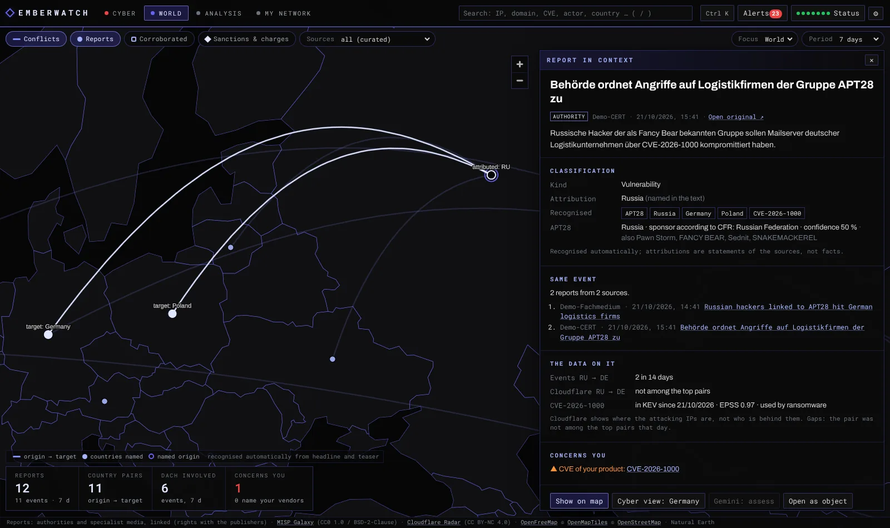
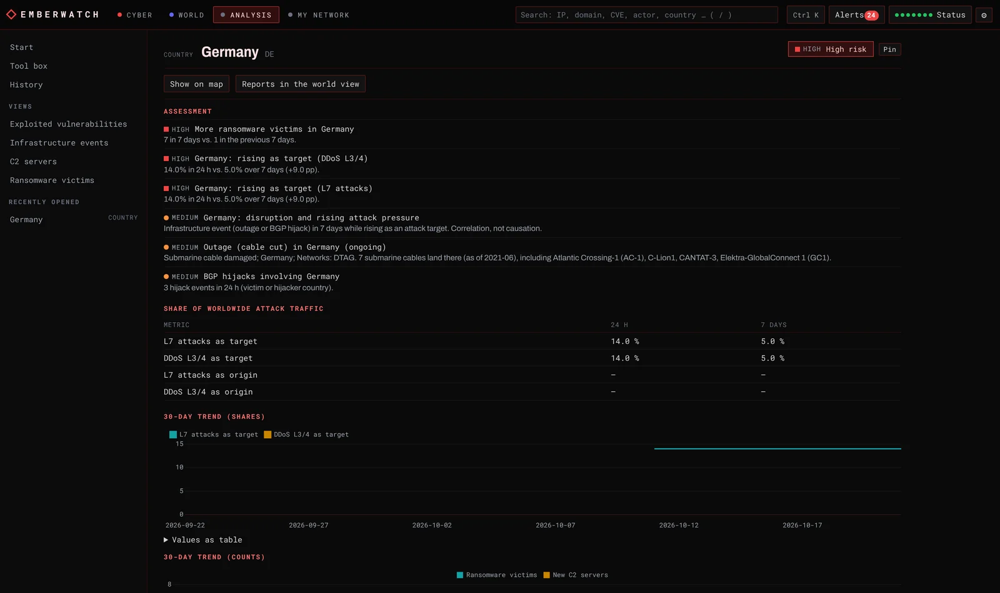
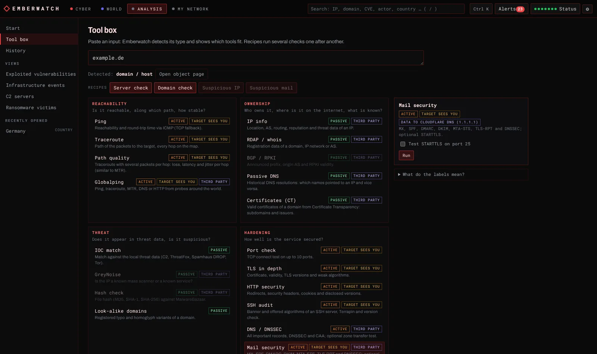

# Emberwatch

Self-hosted cyber threat picture on a world map: attacks, C2 servers, ransomware, exploited vulnerabilities and internet infrastructure from public sources, security reports of authorities and specialist media in their geopolitical context, plus monitoring of your own assets, products and logs.

**English** · [Deutsch](README.de.md)


*Screenshots use synthetic demo data.*

## Features

Emberwatch has four areas: **Cyber** (the world map with attack data, red), **World** (security reports on the same map, indigo), **Analysis** (objects and tools) and **My network** (your own IPs, assets, products and logs). `Ctrl+K` opens a command palette for everything. The selected country and the period carry over between the two map views.

**Cyber – global threat picture**
- World map with L7 attack flows (origin → target), country shading by attack share, reported C2 servers, ransomware victims per country, internet outages, BGP hijacks/route leaks, traffic anomalies and submarine cables; layers are switched with the chips above the map
- *Today*: the few things that matter now – your alerts of the last 48 hours, detected patterns and events many sources report; four key figures below the map (your country as attack target, active C2, ransomware in your region, new KEV that concern you)
- Rankings: target and origin countries (24 h vs. 7 days), DDoS vectors, L7 attack categories, C2 families and hosting networks, ransomware groups and sectors, newly exploited vulnerabilities (CISA KEV with FIRST EPSS)
- Rule-based pattern detection (rising countries and vectors, spikes, new C2 families, KEV clusters, critical outages, correlations) – deterministic and explained, no black box
- Timeline with daily history (up to 90 days) on demand, compact country card with a link to the full country analysis
- Map tool bar on demand: ping, traceroute and IP info with live display on the map; under *More*: path quality (traceroute with several probes per hop), Globalping (measurements from probes worldwide) and mail hops (the delivery path of a mail header on the map)
- Optional Gemini reports (global, country, home region, free questions with follow-ups), exportable as Markdown or PDF. The model only receives aggregated figures.

**World – security reports in context**
- Reports of government CERTs and specialist media (RSS/Atom), with headline, teaser, preview image and a link to the original; reports on the same event are grouped
- Recognised automatically from headline and teaser: countries, the named origin, threat actors (MISP Galaxy), malware, CVEs and the kind of incident (ransomware, DDoS, espionage, sabotage, breach, law enforcement, sanctions, …). Attributions are shown as statements of the sources, labelled as recognised automatically
- Map: country pairs (origin → target according to the reports) and the countries named; filters for corroborated events (an authority or at least two sources), law enforcement & sanctions, sources, focus country or home region, period
- *Report in context*: classification, the same event in other sources, what the local data say about it (KEV/EPSS of the CVEs, active C2 servers of the malware, Cloudflare data for the country pair) and whether it concerns your products, CVEs or domains – such reports also raise alerts
- Actors with their aliases, attributed country and sponsor, confidence, references and the reports naming them; optional Gemini briefing of the period and Gemini assessment of a single report

**Analysis – objects and tools**
- Object pages for IPs, networks, AS numbers, domains, URLs, file hashes, CVEs, countries, malware families, ransomware groups, threat actors and vendors: risk assessment with reasons, everything the local data knows, the relation to your own assets, related objects, your alerts about it, earlier tool runs and an optional Gemini assessment
- Tool box: paste any input (IP, network, AS, domain, URL, e-mail address, hash, CVE or a mail header); Emberwatch detects the type and shows which tools fit, grouped by question:
  - *Reachability:* ping, traceroute, path quality, Globalping
  - *Ownership:* IP info, RDAP/whois, BGP/RPKI (RIPEstat), passive DNS (mnemonic), certificates (Certificate Transparency)
  - *Threat:* local threat data (C2, ThreatFox, Spamhaus DROP, Tor), GreyNoise, file hashes (MalwareBazaar), registered lookalike domains
  - *Hardening:* port check, TLS (versions, weak ciphers, certificate), HTTP security (redirects, headers, cookies, disclosure), SSH audit (algorithms, Terrapin, known vulnerable OpenSSH versions), DNS/DNSSEC/CAA with optional zone transfer test, mail security (MX, SPF incl. lookup count, DMARC, DKIM, MTA-STS, TLS-RPT, DNSSEC, optional STARTTLS)
  - *E-mail:* header analysis (sender and authentication checks, delivery path, links, attachments)
  - *Convert:* CyberChef (in the browser)
- Every tool is labelled: **passive** (only data sources), **active** (harmless contact with the target) or **intrusive** (needs your confirmation per run); plus *target sees you* and which *third party* receives the input
- Recipes run several tools in one go: server check, domain check, suspicious IP, suspicious mail
- Deep views: exploited vulnerabilities (filters, EPSS, marks what affects you), infrastructure events, C2 servers (with block list export), ransomware victims; history of all tool runs (90 days)

**My network**
- Overview: your IPs, alerts of the last 7 days, assets by risk, products, operation
- **My IP:** tracks your home connection and the egress address of this server, records every change and checks both against Spamhaus DROP, Tor, the C2/IOC data, AbuseIPDB and Shodan InternetDB (open ports). The home IP is learned from your visits (with confirmation, optionally automatically within your provider's network), a DynDNS host name or a reporter: `curl` with a token, or any dyndns2 client (routers, ddclient)
- Assets (IPs, networks, AS numbers, domains): matching against C2 servers, ThreatFox IOCs, BGP hijacks/leaks, outages, leak sites, Spamhaus DROP and AbuseIPDB; passive attack surface via Shodan InternetDB; optional active TCP scan after explicit confirmation; Certificate Transparency and lookalike domain monitoring; live BGP monitoring via RIPE RIS Live
- Product watch for vendors/products against CISA KEV and NVD
- Log analysis (upload, also .gz) and optional syslog receiver
- One alert feed with optional Matrix notifications and a daily report

**Interface:** German and English, one side panel on the map (movable and resizable), keyboard shortcuts, start animation, optional login.







## Requirements

- Docker with Docker Compose, or Portainer
- A volume for `/data` (SQLite database, login files, DB-IP geolocation databases). The compose files limit memory to 1 GB.
- Outbound HTTPS to the data sources (see [Data sources](#data-sources-and-licences)); outbound ICMP/UDP for ping and traceroute
- Free API keys for the core sources: Cloudflare (Radar) and abuse.ch. Everything else is optional.

## Installation

### Option A: Portainer with the prebuilt image

1. *Stacks → Add stack → Web editor*, paste [`portainer-stack.yml`](portainer-stack.yml).
2. Under *Environment variables* set at least:
   - `PROXY_NETWORK` – the Docker network of your reverse proxy (Traefik, Nginx Proxy Manager, Pangolin/Newt, …)
   - `CF_API_TOKEN`, `ABUSECH_AUTH_KEY`
   - optionally `LANGUAGE=de`, `AUTH_PASSWORD`, further keys (all variables: [`.env.example`](.env.example))
3. Deploy, then point your reverse proxy to `http://emberwatch:8000`.

### Option B: Docker Compose with the prebuilt image

```bash
git clone https://github.com/SaturdayNetLab/emberwatch.git
cd emberwatch
cp .env.example .env    # add your keys
docker compose pull
docker compose up -d
```

The interface is then available at `http://127.0.0.1:8000`. For access from other machines use a reverse proxy with TLS (see [Reverse proxy](#reverse-proxy-and-login)).

### Option C: build from source

With Docker Compose: set `EMBERWATCH_IMAGE=emberwatch:local` in `.env`, then

```bash
docker compose up -d --build
```

With Portainer: run `git archive -o emberwatch.tar HEAD` in the cloned repository, then *Images → Build a new image → Upload*, select `emberwatch.tar`, image name `emberwatch:local`. Deploy the stack as in option A with `EMBERWATCH_IMAGE=emberwatch:local`.

### Image tags

The image `ghcr.io/saturdaynetlab/emberwatch` is built for `linux/amd64` and `linux/arm64`.

| Tag | Content |
|---|---|
| `latest` | newest release |
| `3`, `3.2` | newest release within this major / minor version |
| `3.2.0` | exactly this release |
| `edge` | current `main` branch, changes between releases |
| `feature-<name>` | test build of a feature branch before it is merged (unstable) |
| `sha-<commit>` | a single build |

## Updating

Your data stays in the `/data` volume. Database changes are applied automatically on start; read the [changelog](CHANGELOG.md) before a new major version.

- **Docker Compose:** `docker compose pull && docker compose up -d`. Run `git pull` beforehand if you want changes to `compose.yml` and `.env.example`.
- **Portainer:** *Stacks → emberwatch → Editor → Update the stack* with the option to re-pull the image enabled.
- **Automatic:** a tool such as Watchtower can pull new images. Pin a version line (for example `3`) if you only want updates without breaking changes.
- **Built from source:** `git pull`, then build again.

New releases are listed on the [releases page](https://github.com/SaturdayNetLab/emberwatch/releases); *Watch → Custom → Releases* on GitHub notifies you.

## Quickstart

1. **Log in.** With the default `AUTH_MODE=password` and no `AUTH_PASSWORD`, a random password is generated on first start:
   ```bash
   docker logs emberwatch 2>&1 | grep "login password"
   docker exec emberwatch cat /data/initial-password.txt
   ```
2. **Wait for data.** The first collection takes a few minutes; the Radar history (30 days by default) is loaded in the background. *Status* shows the state of every source.
3. **Add your assets.** *My network → Assets*: IPs, networks, AS numbers or domains. Active scanning is only possible after you confirm that you are authorised to scan the asset.
4. **Set up My IP.** *My network → My IP*: take over the address you are connected from, enter a DynDNS host name, or create a token for a reporter (see [My IP](#my-ip)).
5. **Watch products.** Search for a vendor, e.g. `Sophos`, and choose *Watch as product*, or add it under *My network → Products*.
6. **Analyse.** Enter an IP, domain, hash, CVE or a mail header under *Analysis*, or press `Ctrl+K` anywhere.
7. **Read the world view.** *World* fills within half an hour after the start. Click a country to focus on it, or a report to see it in context.
8. **Notifications (optional).** Configure Matrix to receive alerts and the daily report.

Keyboard shortcuts: `Ctrl+K` command palette, `1` `2` `3` `4` switch areas, `/` search, `T` map tool bar (in the cyber view; tool box elsewhere), `]` toggles the side panel, `Esc` close (also the report in the world view). The side panel can be moved by its title bar, resized at the bottom right corner and docked again with a double-click on the title bar. Language, window opacity and the start animation are under *Settings* (⚙).

### My IP

The home IP is learned in one of three ways (they can be combined):

1. **When you open Emberwatch**: *My IP* shows the address you are connected from and takes it over on request. Optionally it is taken over automatically whenever you connect from the same network (AS) again, so mobile networks or hotels are ignored (IPv4 only: over IPv6 the browser shows the device's own, often temporary address; devices from the home /64 count as home). This needs a reverse proxy that sets `X-Forwarded-For`.
2. **DynDNS host name**: if a host name points to your connection, Emberwatch resolves it every 10 minutes.
3. **Reporter with a token** (created under *My IP*, shown once, only its hash is stored):
   ```bash
   # cron job on a device at home: the address the request comes from is used
   curl -fsS -X POST -H "Authorization: Bearer <token>" https://emberwatch.example.org/api/myip/report
   ```
   dyndns2 clients (routers, ddclient, inadyn) use `https://emberwatch.example.org/nic/update?myip=<ipaddr>` with HTTP basic auth (any user name, password = token).

Both paths authenticate with the token and are reachable without a session. A valid token is never locked out; after 10 failures within 10 minutes further failures are refused right away (HTTP 429 for the curl reporter). Address changes are accepted at most every 20 seconds per address family. If a login or SSO in front of Emberwatch (e.g. Pangolin, Authelia) protects every path, add an exception for `/api/myip/report` and `/nic/update`.

## Configuration

All settings are environment variables; [`.env.example`](.env.example) lists every variable with its default. The most important ones:

| Variable | Default | Purpose |
|---|---|---|
| `LANGUAGE` | `en` | Language of notifications and daily reports (`de`/`en`). The UI language is chosen per browser. |
| `AUTH_MODE` | `password` | `password` = built-in login, `none` = no login (only behind an authenticating proxy) |
| `AUTH_PASSWORD` | – | Login password; empty = generated on first start |
| `CF_API_TOKEN` | – | Cloudflare API token with Radar read permission (attacks, outages, BGP events) |
| `ABUSECH_AUTH_KEY` | – | abuse.ch Auth-Key (ThreatFox) |
| `RANSOMWARE_LIVE_API_KEY` | – | Optional ransomware.live PRO key; without it the free API is used |
| `ABUSEIPDB_API_KEY` | – | Optional, IP reputation (free tier: 1,000 checks per day) |
| `NVD_API_KEY` | – | Optional, faster product checks (50 instead of 5 requests per 30 s) |
| `CERTSPOTTER_API_KEY` | – | Optional, higher Certificate Transparency limits |
| `GREYNOISE_API_KEY` | – | Optional, GreyNoise community key for the GreyNoise tool (works without a key with a lower limit) |
| `GLOBALPING_TOKEN` | – | Optional, Globalping token (more measurements than without) |
| `CYBERCHEF_URL` | public GCHQ instance | CyberChef used by the tool box, e.g. a self-hosted instance |
| `GEMINI_API_KEY` | – | Optional, AI reports |
| `MATRIX_HOMESERVER`, `MATRIX_ACCESS_TOKEN`, `MATRIX_ROOM_ID` | – | Optional Matrix notifications (bot account in an unencrypted room) |
| `MATRIX_MIN_SEVERITY` | `high` | Minimum severity for notifications |
| `DAILY_REPORT_TIME` | `07:00` | Daily report (local time, `TZ`), empty = off |
| `HOME_REGION`, `HOME_REGION_NAME` | – | Optional home region, e.g. `DE,AT,CH` / `DACH`, adds a region analysis and the region focus of the world view |
| `NEWS_ENABLED` | `1` | `0` switches the world view off (no feeds, no actor list) |
| `NEWS_INTERVAL_MIN` | `30` | Minutes between feed checks (min. 15; conditional requests) |
| `NEWS_IMAGES` | `1` | Preview images of reports; the browser loads them from the publisher (`0` = no images, no `https:` in the image policy) |
| `NEWS_DISABLE` | – | Switch off built-in sources, e.g. `golem,krebs` |
| `NEWS_FEEDS` | – | More feeds: `id\|Name\|https://feed-url[\|gov\|lang]`, several separated by `;` (`gov` = authority) |
| `NEWS_RETENTION_DAYS` | `90` | Days reports are kept (7–365) |
| `TOOLS_ENABLED` | `1` | `0` switches the network tools and the tool box off |
| `TOOLS_ALLOW_PRIVATE` | `0` | `1` = tools and active scans may target private addresses |
| `SCAN_ENABLED` | `1` | `0` disables active scans completely |
| `SYSLOG_ENABLED` | `0` | `1` = syslog receiver on `SYSLOG_PORT` (default 5514, UDP and TCP) |
| `BGP_LIVE` | `1` | Live BGP monitoring of your prefixes |

Where to get the keys:
- Cloudflare: *My Profile → API Tokens → Create Token* (custom token with the Radar read permission)
- abuse.ch: <https://auth.abuse.ch/> (also used for MalwareBazaar hash lookups)
- AbuseIPDB: <https://www.abuseipdb.com/account/api>
- NVD: <https://nvd.nist.gov/developers/request-an-api-key>
- Gemini: <https://aistudio.google.com/apikey>
- GreyNoise: <https://viz.greynoise.io> (account menu → *My API Key*)
- Globalping: <https://dash.globalping.io> (*Tokens*)

## Reverse proxy and login

- Forward to port 8000 of the container. Keep the `Host` header (default in Traefik, Nginx Proxy Manager and Pangolin). If your proxy rewrites it, add the public host to `TRUSTED_ORIGINS`.
- Tool results are streamed (`application/x-ndjson`); proxies must not buffer these responses (Emberwatch sends `X-Accel-Buffering: no`).
- `FORWARDED_ALLOW_IPS` defaults to `*` so that client addresses from the proxy are used (login rate limit, *My IP*). With `*` the leftmost `X-Forwarded-For` entry is trusted; set it to the proxy address if port 8000 is reachable by anything other than the proxy or if your proxy passes on client-supplied headers.
- `/api/myip/report` and `/nic/update` (reporter for *My IP*) check their own token and are reachable without a session; see [My IP](#my-ip) for SSO setups.
- With `AUTH_MODE=none` the login is off. Only use this behind a proxy that authenticates users (e.g. Pangolin, Authelia, Authentik).
- Reset the password: set `AUTH_PASSWORD`, or delete `/data/auth.json` and `/data/initial-password.txt` and restart.

## Security and privacy

- Single-user login: scrypt-hashed password, HMAC-signed session cookie (`HttpOnly`, `SameSite=Strict`, `Secure` on HTTPS), brute-force limit, same-origin checks for all API requests, strict Content Security Policy.
- The container runs as an unprivileged user with a read-only root filesystem, all capabilities dropped and `no-new-privileges`.
- Network tools and scans only reach public addresses unless `TOOLS_ALLOW_PRIVATE=1`; host names are resolved once and every address is checked (no DNS rebinding); no shell is involved. Private addresses and internal names (single-label names, `.local`, `.lan`, `.internal`, `.home.arpa`, `fritz.box` and similar) are never sent to a third party, Gemini included; Globalping additionally resolves a name locally first and refuses it if it points to a private address. The DNS tool sends internal names only to the system resolver. Names under public domains that only resolve internally (e.g. `dc01.ad.example.com`) cannot be recognised and are treated like public names.
- Every tool shows whether it is passive, active or intrusive, whether the target sees the request and which third party receives the input. The zone transfer test needs a confirmation per run. Links from outside (bookmarks, other sites) open the tool box but never start a run by themselves.
- **Active scans:** only scan systems you own or are authorised to test. Emberwatch scans an asset only after explicit confirmation and limits hosts, ports and parallelism. Scanning third-party systems can be illegal.
- Uploaded logs are processed in a temporary file and deleted immediately; only the result goes back to the browser. Syslog lines are only kept as alerts for known indicators.
- Gemini situation reports only receive aggregated figures and detected patterns: no victim names, no raw IOCs, no assets, no log contents. The Gemini assessment of an object (only on request) sends the object and the data of its page; your own assets, IPs and products are reduced to a flag and leak site victim names are left out. World view briefings and report assessments send headlines, teasers, sources and the recognised public entities; whether a report concerns you is sent as a flag only.
- World view: feeds are read with entity expansion and external references disabled (defusedxml), at most 5 MB each, with conditional requests; redirects must stay on HTTPS and public addresses. Preview images are taken from the feed or from the article page, which is only fetched from the source's own domain and public addresses (at most 400 KB, three redirects, each checked). Headlines and teasers are shown as text; links and images are HTTPS only, images are loaded without a referrer.
- *My IP* stores the addresses the interface is opened from (90 days), the history of your home and server IPs and the hash of the reporter token. Tool runs are stored for 90 days (at most 3,000) and can be deleted in the history; Gemini analyses are kept as long as alerts (`ALERT_RETENTION_DAYS`, at most 2,000).
- Request bodies are limited: 20 MB with a session (mail analysis up to 15 MB), 64 KB without one (login, reporter).
- Outbound connections: the data sources listed below, the basemap tiles (OpenFreeMap, loaded by the browser), preview images of reports (loaded by the browser from the publishers, `NEWS_IMAGES=0` turns this off), DB-IP downloads, the targets you choose in the tools or scans, and the third parties of the tools you run (labelled in the interface). CyberChef opens in the browser; the input stays in the URL fragment and is not sent to a server.
- Backups: everything lives in the `/data` volume (`emberwatch.sqlite`, login files, geolocation databases).

## Architecture

```
Browser (vanilla JS, MapLibre, Chart.js)  ──HTTPS──  reverse proxy  ──  Emberwatch container
                                                                          FastAPI + uvicorn (1 worker)
                                                                          ├─ collectors (asyncio loops) ── public sources
                                                                          ├─ world view: feeds, recognition, actors (MISP Galaxy)
                                                                          ├─ asset monitors: InternetDB, scans, CT, typo, RIS Live
                                                                          ├─ own IP tracking (visits, DynDNS, reporter)
                                                                          ├─ tool box (NDJSON streams) and object pages
                                                                          ├─ alerts → Matrix
                                                                          ├─ log analysis / syslog receiver
                                                                          └─ SQLite (/data)
```

- Backend: `backend/app` (one module per concern: `sources/` collectors, `analytics.py` patterns, `surface.py` attack surface and scans, `domains.py` CT and lookalikes, `bgp.py` RIS Live, `products.py` KEV/NVD, `logs.py` log analysis and syslog, `reputation.py`, `alerts.py`, `auth.py`, `i18n.py`, `objects.py` object pages, `myip.py` own IPs, `news.py` feeds and reports, `nlp.py` recognition, `actors.py` threat actors).
- Tool box: `backend/app/toolbox` – `registry.py` describes every tool (inputs, level, flags, parameters) and is the single source for the interface and the server-side validation; `detect.py` input detection; `result.py` the unified result format; `tools_*.py` the tools by question; `runner.py` runs, recipes and history.
- Texts the backend produces (patterns, alerts, errors) are stored language-neutral and rendered per request in German or English.
- Frontend: `frontend/` without a build step; all dynamic content is inserted as text, never as HTML. `router.js` (areas), `maptools.js` (map tool bar), `welt.js` (world view), `analyse.js` (objects, tool box, views), `netz.js` and `assets.js` (my network), `result.js` (renders every tool result), `palette.js` (`Ctrl+K`).

## Data sources and licences

| Source | Used for | Terms |
|---|---|---|
| [Cloudflare Radar](https://radar.cloudflare.com) | attack shares, vectors, outages, BGP hijacks/leaks, anomalies | CC BY-NC 4.0 |
| [abuse.ch](https://abuse.ch) Feodo Tracker, ThreatFox | C2 servers, IOCs | abuse.ch terms of use |
| [Ransomware.live](https://www.ransomware.live) | leak site victims | attribution required, no redistribution of raw data |
| [CISA KEV](https://www.cisa.gov/known-exploited-vulnerabilities-catalog) | exploited vulnerabilities | public |
| [FIRST EPSS](https://www.first.org/epss/) | exploitation probability | FIRST terms |
| [NVD](https://nvd.nist.gov) | CVEs for watched products | This product uses data from the NVD API but is not endorsed or certified by the NVD. |
| [Shodan InternetDB](https://internetdb.shodan.io) | passive attack surface | free for non-commercial use |
| [Spamhaus DROP](https://www.spamhaus.org/drop/) | hijacked networks | free use with attribution to The Spamhaus Project |
| [Tor Project](https://check.torproject.org/torbulkexitlist) | Tor exit nodes | public |
| [AbuseIPDB](https://www.abuseipdb.com) | IP reputation (optional) | AbuseIPDB terms |
| [RIPE NCC RIS Live, RIPEstat](https://ris-live.ripe.net) | live BGP, routing | RIPE NCC terms |
| [Cert Spotter](https://sslmate.com/certspotter/) | Certificate Transparency | SSLMate terms |
| [Globalping](https://globalping.io) (jsDelivr) | measurements from probes worldwide (tool, on request) | Globalping terms |
| [mnemonic PassiveDNS](https://docs.mnemonic.no/api/services/pdns/) | passive DNS (tool, on request) | mnemonic terms |
| [GreyNoise Community API](https://www.greynoise.io) | internet scanners and benign services (tool, on request) | GreyNoise terms |
| [MalwareBazaar](https://bazaar.abuse.ch) (abuse.ch) | file hashes (tool, on request) | abuse.ch terms of use |
| [rdap.org](https://rdap.org) | RDAP bootstrap (whois tool) | public |
| [MISP Galaxy](https://github.com/MISP/misp-galaxy) (threat-actor cluster) | threat actors, aliases, attributions | CC0 1.0 / BSD 2-Clause |
| World view feeds: [NCSC UK](https://www.ncsc.gov.uk), [BSI](https://www.bsi.bund.de), [The Record](https://therecord.media), [BleepingComputer](https://www.bleepingcomputer.com), [SecurityWeek](https://www.securityweek.com), [Krebs on Security](https://krebsonsecurity.com), [Golem.de](https://www.golem.de) | headlines, teasers and preview images of security reports, linked to the original | rights stay with the publishers; Emberwatch shows what the feeds publish and links to the article |
| [CyberChef](https://github.com/gchq/CyberChef) (GCHQ) | decoding in the browser (link) | Apache 2.0 |
| [DB-IP Lite](https://db-ip.com) | IP geolocation and ASN | CC BY 4.0 |
| [TeleGeography](https://www.submarinecablemap.com) | submarine cables (snapshot 2021) | CC BY-NC-SA 3.0 |
| [OpenFreeMap](https://openfreemap.org), OpenMapTiles, OpenStreetMap | basemap | see [THIRD_PARTY_NOTICES.md](THIRD_PARTY_NOTICES.md) |
| [Natural Earth](https://www.naturalearthdata.com) | country shapes (offline map) | public domain |

Several sources only allow non-commercial use. Emberwatch is meant for private and non-commercial use; see [Licence](#licence).

## Limitations

- Cloudflare values are shares of the traffic Cloudflare sees, not absolute attack counts. Origin is where the attacking IPs are, not who is behind them.
- World view: recognition works on headline and teaser and is rule-based; it can miss or misread countries, actors and kinds (e.g. a name that is also an ordinary word). An origin is an attribution by a source or the country the MISP Galaxy gives for the recognised actor, not proof. The number of reports shows coverage, which depends on the sources and their languages, not the scale of attacks. Preview images come from the publishers and may be missing.
- Geolocation (DB-IP Lite) is approximate.
- InternetDB is updated about weekly; a port opened today may only appear days later. Use the active scan for current results.
- The product watch matches NVD descriptions by keyword; generic names can produce false positives.
- Lookalike detection uses a heuristic for registrable domains (no Public Suffix List) and treats any DNS answer other than NXDOMAIN as registered.
- BGP alerts are heuristics without RPKI validation; a new upstream or a DDoS mitigation service can trigger them.
- Syslog is received unencrypted; restrict senders with `SYSLOG_ALLOW` and your firewall. With Docker's port publishing all senders may appear with the Docker gateway address.
- Third-party tools have rate limits (e.g. mnemonic PassiveDNS without a key: 10 requests per minute); answers of passive DNS, GreyNoise and MalwareBazaar are cached for 24 hours.
- *My IP* via visits needs a reverse proxy that sets `X-Forwarded-For`; behind CGNAT the home IP is the provider's shared address.
- One user (one password), one instance (SQLite, one worker).

## Development

```bash
cd backend
pip install -r requirements-dev.txt
python -m pytest -q tests            # tests use mocked upstream APIs
COLLECTORS=0 AUTH_MODE=none DATA_DIR=../data STATIC_DIR=../frontend uvicorn app.main:app --reload
```

`scripts/` contains the generators for the bundled map data (basemap style, country shapes, submarine cables).

## Changelog

See [CHANGELOG.md](CHANGELOG.md).

## Licence

Emberwatch is licensed under the [PolyForm Noncommercial License 1.0.0](LICENSE.md): free for personal and other non-commercial use, no commercial use. Third-party components and data keep their own licences, see [THIRD_PARTY_NOTICES.md](THIRD_PARTY_NOTICES.md).

Required Notice: Copyright (c) 2026 SaturdayNetLab (https://github.com/SaturdayNetLab)
