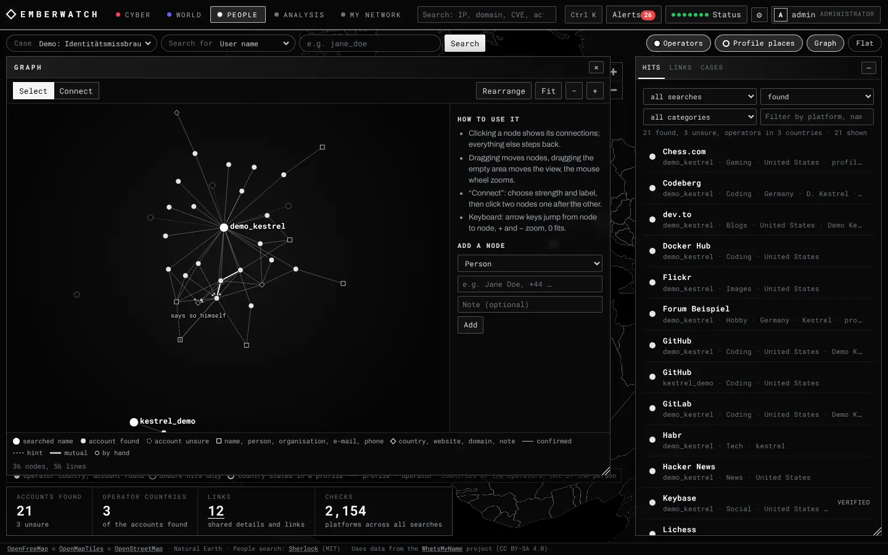
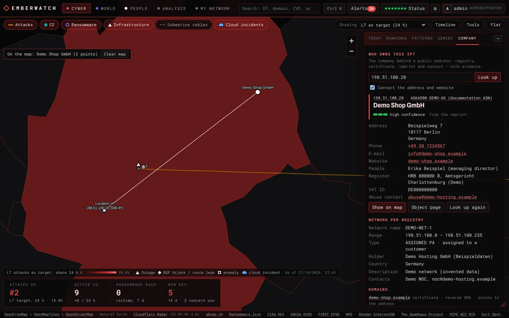
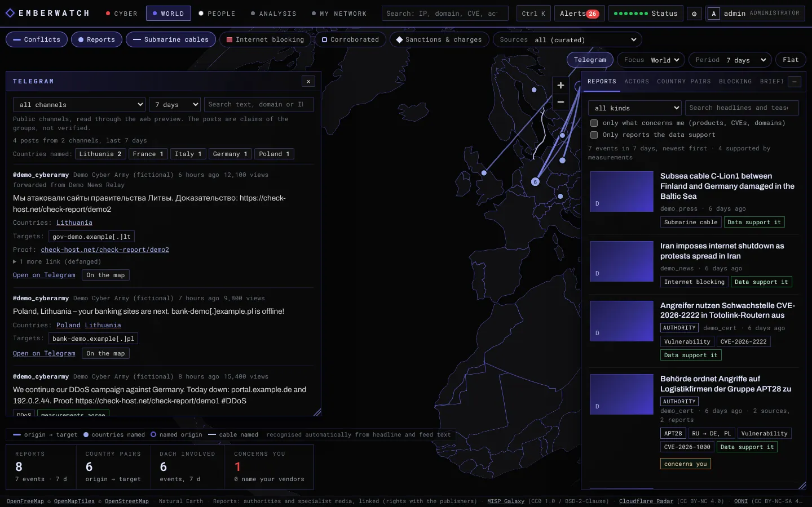

# Emberwatch

Self-hosted cyber threat picture on a world map: attacks, C2 servers, ransomware, exploited vulnerabilities, internet infrastructure and cloud outages from public sources, security reports of authorities and specialist media in their geopolitical context – checked against measurements –, the claims of hacktivist channels, the company behind an IP address and a people search with a link graph, plus monitoring of your own assets, products and logs. Accounts with roles and a second factor.

**English** · [Deutsch](README.de.md)


*Screenshots use synthetic demo data.*

## Features

Emberwatch has five areas: **Cyber** (the world map with attack data, red), **World** (security reports and Telegram channels on the same map, indigo), **People** (a people search on the map in black and white, administrators only), **Analysis** (objects and tools) and **My network** (your own IPs, assets, products and logs). `Ctrl+K` opens a command palette for everything. The selected country and the period carry over between the cyber and the world view.

**Cyber – global threat picture**
- World map with L7 attack flows (origin → target), country shading by attack share, reported C2 servers, ransomware victims per country, internet outages, BGP hijacks/route leaks, traffic anomalies, submarine cables and active incidents of AWS, Azure, Google Cloud and Cloudflare at the affected region; layers are switched with the chips above the map
- *Today*: the few things that matter now – your alerts of the last 48 hours, detected patterns and events many sources report; four key figures below the map (your country as attack target, active C2, ransomware in your region, new KEV that concern you)
- Rankings: target and origin countries (24 h vs. 7 days), DDoS vectors, L7 attack categories, C2 families and hosting networks, ransomware groups and sectors, newly exploited vulnerabilities (CISA KEV with FIRST EPSS)
- Rule-based pattern detection (rising countries and vectors, spikes, new C2 families, KEV clusters, critical outages, correlations) – deterministic and explained, no black box
- Timeline with daily history (up to 90 days) on demand, compact country card with a link to the full country analysis
- Map tool bar on demand: ping, traceroute and IP info with live display on the map; under *More*: path quality (traceroute with several probes per hop), Globalping (measurements from probes worldwide) and mail hops (the delivery path of a mail header on the map)
- **Who owns this IP?** (side tab *Company*): the company that uses a public address – network holder according to the registry (RDAP), AS, reverse DNS, the certificate on port 443, domains that point to the address, imprint and schema.org data of the website – with contact (phone, e-mail, website, people, register, VAT ID) and abuse contact, every step as evidence and a confidence; company seat and location of the address on the map
- Optional Gemini reports (global, country, home region, free questions with follow-ups), exportable as Markdown or PDF. The model only receives aggregated figures.

**World – security reports in context**
- Reports of government CERTs and specialist media (RSS/Atom), with headline, teaser, preview image and a link to the original; reports on the same event are grouped. Optionally the worldwide press via GDELT: headlines from news sites around the world, marked as unverified, shown only when chosen as source, kept apart from the curated sources and never alerted
- Recognised automatically from headline and feed text (up to 1,500 characters): countries, the named origin, threat actors (MISP Galaxy), malware, CVEs, submarine cables named in the report and the kind of incident (ransomware, DDoS, espionage, sabotage, breach, submarine cable, internet blocking, law enforcement, sanctions, …). Attributions are shown as statements of the sources, labelled as recognised automatically
- **Compared with measurements:** each report is checked against Emberwatch's own data – a DDoS against the Cloudflare share of the target country (compared with the 14 days before), ransomware against the group's leak site posts, cable damage and shutdowns against internet outages, blocking against a rise in OONI measurements compared with the 4 weeks before, CVEs against CISA KEV and ENISA, malware against active C2 servers. The result (supported, not supported, unclear) is shown with the numbers behind it; a filter shows only reports the data support. Measurements show traffic, posts and outages, not who is behind them
- Map: country pairs (origin → target according to the reports), the countries named, the submarine cables named and internet blocking (confirmed blocking according to OONI, shutdowns Cloudflare attributes to a government); filters for corroborated events (an authority or at least two sources), law enforcement & sanctions, sources, focus country or home region, period
- *Blocking* tab: shutdowns ordered by governments and OONI measurements per country (confirmed blocking, anomalous websites and messengers, compared with the period before), with links to OONI Explorer and IODA
- *Report in context*: classification, the same event in other sources, the comparison with measurements, the submarine cables named, what the local data say about it (KEV, ENISA, EPSS and public exploit code of the CVEs, active C2 servers of the malware, Cloudflare data for the country pair) and whether it concerns your products, CVEs or domains – such reports also raise alerts
- Actors with their aliases, attributed country and sponsor, confidence, references and the reports naming them; optional Gemini briefing of the period and Gemini assessment of a single report
- **Telegram** window: public channels of hacktivist groups (web preview, no account) with the countries, kinds of attack and targets each post claims (domains and addresses defanged), proof links, the comparison of claimed DDoS attacks with Cloudflare Radar and a translation with Gemini on request

**People – accounts behind a user name (administrators)**
- A user name, an e-mail address or a name (turned into common user name variants) is checked on several hundred platforms from the site lists of [Sherlock](https://github.com/sherlock-project/sherlock) and [WhatsMyName](https://github.com/WebBreacher/WhatsMyName); adult, dating, health and political sites are excluded
- Each hit: whether an account exists (found or unsure), the country of the platform operator and the public profile details (name, place, company, links, links the platform verified, e-mail) from the platform APIs (GitHub, Keybase, Mastodon, Hacker News, Docker Hub, Codeberg, dev.to, Lichess, Chess.com, Reddit) or the profile page; optionally Gravatar for an e-mail address
- **Link graph:** what connects the accounts – details several profiles state, links between accounts (mutual, verified by the platform) – plus your own nodes and lines (confirmed or hint); the side panel lists the same links in words
- Cases with a purpose, export as JSON, automatic deletion after 90 days without change; every search is in the audit log. A hit only means that an account with this name exists – whether it is the same person shows in the links

**Analysis – objects and tools**
- Object pages for IPs, networks, AS numbers, domains, URLs, file hashes, CVEs, countries, malware families, ransomware groups, threat actors and vendors: risk assessment with reasons, everything the local data knows, the relation to your own assets, related objects, your alerts about it, earlier tool runs and an optional Gemini assessment. Threat actors and malware show their techniques by tactic and the software they use according to MITRE ATT&CK; CVEs show whether ENISA lists them as exploited and whether public exploit code (Metasploit modules) or check templates (Nuclei) exist
- Tool box: paste any input (IP, network, AS, domain, URL, e-mail address, hash, CVE or a mail header); Emberwatch detects the type and shows which tools fit, grouped by question:
  - *Reachability:* ping, traceroute, path quality, Globalping
  - *Ownership:* IP info, RDAP/whois, BGP/RPKI (RIPEstat), passive DNS (mnemonic), certificates (Certificate Transparency)
  - *Threat:* local threat data (C2, ThreatFox, Spamhaus DROP, Tor), GreyNoise, file hashes (MalwareBazaar), registered lookalike domains
  - *Hardening:* port check, TLS (versions, weak ciphers, certificate), HTTP security (redirects, headers, cookies, disclosure), SSH audit (algorithms, Terrapin, known vulnerable OpenSSH versions), DNS/DNSSEC/CAA with optional zone transfer test, mail security (MX, SPF incl. lookup count, DMARC, DKIM, MTA-STS, TLS-RPT, DNSSEC, optional STARTTLS)
  - *E-mail:* header analysis (sender and authentication checks, delivery path, links, attachments)
  - *Convert:* CyberChef (in the browser)
- Every tool is labelled: **passive** (only data sources), **active** (harmless contact with the target) or **intrusive** (needs your confirmation per run); plus *target sees you* and which *third party* receives the input
- Recipes run several tools in one go: server check, domain check, suspicious IP, suspicious mail
- Deep views: exploited vulnerabilities (CISA KEV, or exploited according to ENISA but not in KEV; filters, EPSS, public exploit code, marks what affects you), infrastructure events, C2 servers (with block list export), ransomware victims, platform incidents (AWS, Azure, Google Cloud, Cloudflare, with regions); history of all tool runs (90 days)

**My network**
- Overview: your IPs, alerts of the last 7 days, assets by risk, products, operation
- **My IP:** tracks your home connection and the egress address of this server, records every change and checks both against Spamhaus DROP, Tor, the C2/IOC data, AbuseIPDB and Shodan InternetDB (open ports). The home IP is learned from your visits (with confirmation, optionally automatically within your provider's network), a DynDNS host name or a reporter: `curl` with a token, or any dyndns2 client (routers, ddclient)
- Assets (IPs, networks, AS numbers, domains): matching against C2 servers, ThreatFox IOCs, URLhaus malware URLs, BGP hijacks/leaks, outages, leak sites, Spamhaus DROP and AbuseIPDB; passive attack surface via Shodan InternetDB; optional active TCP scan after explicit confirmation; Certificate Transparency and lookalike domain monitoring; live BGP monitoring via RIPE RIS Live
- Product watch for vendors/products against CISA KEV and NVD; the cloud platforms you use (AWS, Azure, Google Cloud, Cloudflare) raise an alert for each new incident on their status page
- Log analysis (upload, also .gz) and optional syslog receiver
- One alert feed with optional Matrix notifications and a daily report

**Interface:** German and English, accounts with the roles administrator and read-only and a second factor (TOTP), one side panel on the map and windows (movable and resizable), a globe that turns while nobody uses the map, keyboard shortcuts, start animation.








## Requirements

- Docker with Docker Compose, or Portainer
- A volume for `/data` (SQLite database with the accounts, the key file `session.key`, DB-IP geolocation databases, site lists of the people search). The compose files limit memory to 1 GB.
- Outbound HTTPS to the data sources (see [Data sources](#data-sources-and-licences)); outbound ICMP/UDP for ping and traceroute
- Free API keys for the core sources: Cloudflare (Radar) and abuse.ch. Everything else is optional.

## Installation

### Option A: Portainer with the prebuilt image

1. *Stacks → Add stack → Web editor*, paste [`portainer-stack.yml`](portainer-stack.yml).
2. Under *Environment variables* set at least:
   - `PROXY_NETWORK` – the Docker network of your reverse proxy (Traefik, Nginx Proxy Manager, Pangolin/Newt, …)
   - `CF_API_TOKEN`, `ABUSECH_AUTH_KEY`
   - optionally `LANGUAGE=de`, `AUTH_USER` and `AUTH_PASSWORD` for the first administrator, further keys (all variables: [`.env.example`](.env.example))
3. Deploy, then point your reverse proxy to `http://emberwatch:8000`.

### Option B: Docker Compose with the prebuilt image

```bash
git clone https://github.com/Just-Franning/Emberwatch.git
cd Emberwatch
cp .env.example .env    # add your keys
docker compose pull
docker compose up -d
```

The interface is then available at `http://127.0.0.1:8000`. For access from other machines use a reverse proxy with TLS (see [Reverse proxy](#reverse-proxy)).

### Option C: build from source

With Docker Compose: set `EMBERWATCH_IMAGE=emberwatch:local` in `.env`, then

```bash
docker compose up -d --build
```

With Portainer: run `git archive -o emberwatch.tar HEAD` in the cloned repository, then *Images → Build a new image → Upload*, select `emberwatch.tar`, image name `emberwatch:local`. Deploy the stack as in option A with `EMBERWATCH_IMAGE=emberwatch:local`.

### Image tags

The image `ghcr.io/just-franning/emberwatch` is built for `linux/amd64` and `linux/arm64`.

| Tag | Content |
|---|---|
| `latest` | newest release |
| `4`, `4.0` | newest release within this major / minor version |
| `4.0.0` | exactly this release |
| `edge` | current `main` branch, changes between releases |
| `feature-<name>` | test build of a feature branch before it is merged (unstable) |
| `sha-<commit>` | a single build |

## Updating

Your data stays in the `/data` volume. Database changes are applied automatically on start; read the [changelog](CHANGELOG.md) before a new major version. **From 3.x to 4.0** the sign-in changes to accounts with a second factor: your password keeps working for the account `admin`, the authenticator app is set up at the first sign-in (see [Accounts and sign-in](#accounts-and-sign-in)). The image is now `ghcr.io/just-franning/emberwatch` (the repository moved to Just-Franning): change `image:` or `EMBERWATCH_IMAGE`.

- **Docker Compose:** `docker compose pull && docker compose up -d`. Run `git pull` beforehand if you want changes to `compose.yml` and `.env.example`.
- **Portainer:** *Stacks → emberwatch → Editor → Update the stack* with the option to re-pull the image enabled.
- **Automatic:** a tool such as Watchtower can pull new images. Pin a version line (for example `4`) if you only want updates without breaking changes.
- **Built from source:** `git pull`, then build again.

New releases are listed on the [releases page](https://github.com/Just-Franning/Emberwatch/releases); *Watch → Custom → Releases* on GitHub notifies you.

## Quickstart

1. **Sign in.** The first administrator is `admin` (another name with `AUTH_USER`). Its password is `AUTH_PASSWORD`, after an update from 3.x the password you used so far, otherwise it is generated on first start and must be changed at the first sign-in:
   ```bash
   docker logs emberwatch 2>&1 | grep "created with the password"
   docker exec emberwatch cat /data/initial-password.txt
   ```
   At the first sign-in you set up the second factor with an authenticator app (Aegis, 2FAS, Google Authenticator, …) and store the ten recovery codes.
2. **Add accounts (optional).** User menu (top right) → *Users*: read-only accounts for colleagues, further administrators.
3. **Wait for data.** The first collection takes a few minutes; the Radar history (30 days by default) is loaded in the background. *Status* shows the state of every source.
4. **Add your assets.** *My network → Assets*: IPs, networks, AS numbers or domains. Active scanning is only possible after you confirm that you are authorised to scan the asset.
5. **Set up My IP.** *My network → My IP*: take over the address you are connected from, enter a DynDNS host name, or create a token for a reporter (see [My IP](#my-ip)).
6. **Watch products.** Search for a vendor, e.g. `Sophos`, and choose *Watch as product*, or add it under *My network → Products*.
7. **Analyse.** Enter an IP, domain, hash, CVE or a mail header under *Analysis*, or press `Ctrl+K` anywhere. For an IP address, *Who owns this IP?* shows the company behind it.
8. **Read the world view.** *World* fills within half an hour after the start. Click a country to focus on it, or a report to see it in context. Add hacktivist channels in the *Telegram* window.
9. **Notifications (optional).** Configure Matrix to receive alerts and the daily report.

Keyboard shortcuts: `Ctrl+K` command palette, `1` to `5` switch areas (`1` to `4` for read-only accounts, which have no *People*), `/` search, `T` map tool bar (in the cyber view; tool box elsewhere), `]` toggles the side panel, `Esc` close (also the report in the world view). The side panel can be moved by its title bar, resized at the bottom right corner and docked again with a double-click on the title bar. Language, window opacity, the start animation and the turning globe are under *Settings* (⚙).

### My IP

The home IP is learned in one of three ways (they can be combined):

1. **When you open Emberwatch**: *My IP* shows the address you are connected from and takes it over on request. Optionally it is taken over automatically whenever you connect from the same network (AS) again, so mobile networks or hotels are ignored (IPv4 only: over IPv6 the browser shows the device's own, often temporary address; devices from the home /64 count as home). This needs a reverse proxy that sets `X-Forwarded-For`.
2. **DynDNS host name**: if a host name points to your connection, Emberwatch resolves it every 10 minutes.
3. **Reporter with a token** (created under *My IP*, shown once, only its hash is stored):
   ```bash
   # cron job on a device at home: the address the request comes from is used
   curl -fsS -X POST -H "Authorization: Bearer <token>" https://emberwatch.example.org/api/myip/report
   ```
   dyndns2 clients (routers, ddclient, inadyn) use `https://emberwatch.example.org/nic/update?myip=<ipaddr>` with HTTP basic auth (any user name, password = token).

Both paths authenticate with the token and are reachable without a session. A valid token is never locked out; after 10 failures within 10 minutes further failures are refused right away (HTTP 429 for the curl reporter). Address changes are accepted at most every 20 seconds per address family. If a login or SSO in front of Emberwatch (e.g. Pangolin, Authelia) protects every path, add an exception for `/api/myip/report` and `/nic/update`.

## Configuration

All settings are environment variables; [`.env.example`](.env.example) lists every variable with its default. The most important ones:

| Variable | Default | Purpose |
|---|---|---|
| `LANGUAGE` | `en` | Language of notifications and daily reports (`de`/`en`). The UI language is chosen per browser. |
| `AUTH_MODE` | `password` | `password` = accounts with password and second factor, `none` = no sign-in (only behind an authenticating proxy, see [Accounts](#accounts-and-sign-in)) |
| `AUTH_USER` | `admin` | Name of the first administrator, created on the first start of 4.x |
| `AUTH_PASSWORD` | – | Password of that first administrator, used only when it is created; empty = the password of 3.x keeps working, otherwise one is generated |
| `SESSION_HOURS` | `12` | Lifetime of a session |
| `AUDIT_RETENTION_DAYS` | `365` | Days the audit log is kept (30–3650) |
| `CF_API_TOKEN` | – | Cloudflare API token with Radar read permission (attacks, outages, BGP events) |
| `ABUSECH_AUTH_KEY` | – | abuse.ch Auth-Key (ThreatFox, URLhaus, MalwareBazaar) |
| `RANSOMWARE_LIVE_API_KEY` | – | Optional ransomware.live PRO key; without it the free API is used |
| `ABUSEIPDB_API_KEY` | – | Optional, IP reputation (free tier: 1,000 checks per day) |
| `NVD_API_KEY` | – | Optional, faster product checks (50 instead of 5 requests per 30 s) |
| `CERTSPOTTER_API_KEY` | – | Optional, higher Certificate Transparency limits |
| `GREYNOISE_API_KEY` | – | Optional, GreyNoise community key for the GreyNoise tool (works without a key with a lower limit) |
| `GLOBALPING_TOKEN` | – | Optional, Globalping token (more measurements than without) |
| `CYBERCHEF_URL` | public GCHQ instance | CyberChef used by the tool box, e.g. a self-hosted instance |
| `GEMINI_API_KEY` | – | Optional, AI reports |
| `MATRIX_HOMESERVER`, `MATRIX_ACCESS_TOKEN`, `MATRIX_ROOM_ID` | – | Optional Matrix notifications (bot account in an unencrypted room) |
| `MATRIX_MIN_SEVERITY` | `high` | Minimum severity for notifications |
| `DAILY_REPORT_TIME` | `07:00` | Daily report (local time, `TZ`), empty = off |
| `HOME_REGION`, `HOME_REGION_NAME` | – | Optional home region, e.g. `DE,AT,CH` / `DACH`, adds a region analysis and the region focus of the world view |
| `NEWS_ENABLED` | `1` | `0` switches the world view off (no feeds, no actor list) |
| `NEWS_INTERVAL_MIN` | `30` | Minutes between feed checks (min. 15; conditional requests) |
| `NEWS_IMAGES` | `1` | Preview images of reports; the browser loads them from the publisher (`0` = no images, no `https:` in the image policy) |
| `NEWS_DISABLE` | – | Switch off built-in sources, e.g. `golem,krebs` |
| `NEWS_FEEDS` | – | More feeds: `id\|Name\|https://feed-url[\|gov\|lang]`, several separated by `;` (`gov` = authority) |
| `NEWS_RETENTION_DAYS` | `90` | Days reports are kept (7–365); the worldwide press (GDELT) at most 14 days and 8,000 headlines |
| `SOURCES_DISABLE` | – | Switch off optional sources, comma-separated: `ooni` (blocking measurements), `gdelt` (worldwide press), `attack` (MITRE ATT&CK), `euvd` (ENISA), `exploits` (Metasploit/Nuclei metadata), `urlhaus`, `cloud_status` (platform incidents) |
| `TOOLS_ENABLED` | `1` | `0` switches the network tools and the tool box off |
| `TOOLS_ALLOW_PRIVATE` | `0` | `1` = tools and active scans may target private addresses |
| `SCAN_ENABLED` | `1` | `0` disables active scans completely |
| `SYSLOG_ENABLED` | `0` | `1` = syslog receiver on `SYSLOG_PORT` (default 5514, UDP and TCP) |
| `BGP_LIVE` | `1` | Live BGP monitoring of your prefixes |
| `NOMINATIM_URL` | public OpenStreetMap instance | Coordinates of company addresses for *Who owns this IP?*; another instance, or `off` |
| `OSINT_ENABLED` | `1` | `0` switches the people search off |
| `OSINT_RETENTION_DAYS` | `90` | Days a case of the people search is kept after its last change |
| `GRAVATAR_API_KEY` | – | Optional: the people search also looks up an e-mail address at Gravatar |
| `TELEGRAM_ENABLED` | `1` | `0` switches the Telegram window off |
| `TELEGRAM_INTERVAL_MIN` | `15` | Minutes between two readings of all channels (min. 10) |
| `TELEGRAM_RETENTION_DAYS` | `90` | Days posts are kept (7–365) |

Where to get the keys:
- Cloudflare: *My Profile → API Tokens → Create Token* (custom token with the Radar read permission)
- abuse.ch: <https://auth.abuse.ch/> (also used for MalwareBazaar hash lookups)
- AbuseIPDB: <https://www.abuseipdb.com/account/api>
- NVD: <https://nvd.nist.gov/developers/request-an-api-key>
- Gemini: <https://aistudio.google.com/apikey>
- GreyNoise: <https://viz.greynoise.io> (account menu → *My API Key*)
- Globalping: <https://dash.globalping.io> (*Tokens*)
- Gravatar: <https://gravatar.com/developers/> (create an application, then an API key)

## Accounts and sign-in

Everyone signs in with an own account: user name, password (at least 12 characters) and a code of an authenticator app (TOTP according to RFC 6238 – 6 digits, 30 seconds; Aegis, 2FAS, Google or Microsoft Authenticator, password managers with TOTP, …). The second factor is mandatory.

| Role | May |
|---|---|
| Administrator | everything: tools, scans, analyses, *Who owns this IP?*, the people search, Telegram channels, changes of every kind, accounts and the audit log |
| Read-only | read every view (cyber, world, analysis, my network, stored company lookups, Telegram posts) and manage the own account; no tools, scans, Gemini runs or changes, no people search, no user administration |

The roles are checked on the server for every request; the interface only hides what a role cannot use.

- **New account:** an administrator adds it under *Users* (user menu, top right) and passes on the one-time password (shown once). It is changed at the first sign-in; then the authenticator app is set up (QR code or key) and ten recovery codes are shown once – each replaces one code, once.
- **Own account** (*My account*): change the password, set up a new authenticator app (e.g. a new phone), create new recovery codes, see and end sessions. A new password or authenticator ends all other sessions.
- **User administration** (*Users*, administrators): add accounts, change the role, disable, reset the password (new one-time password) or the second factor, end sessions, delete. The own account is managed under *My account*; the last active administrator cannot be demoted, disabled or deleted.
- **Audit log** (*Audit log*, administrators): sign-ins and failed attempts, account changes, people searches, company lookups and changes of the Telegram channels, with time, account and address; kept for `AUDIT_RETENTION_DAYS`.
- **Sessions** last `SESSION_HOURS` and end at sign-out, with a new password or authenticator, and when an administrator disables the account, resets it or ends its sessions.
- **Brute force:** 10 failed attempts per client within 10 minutes, 100 in total; wrong codes also count per account (10 within 10 minutes).

**From 3.x:** the first start of 4.x creates the administrator `admin` (`AUTH_USER`) with the password used so far (`AUTH_PASSWORD`, or the generated password of 3.x); sessions of 3.x end. The authenticator app is set up at the first sign-in. After that `AUTH_PASSWORD` has no effect: passwords are changed in the interface or with `emberwatch-admin`.

**Lost access** (e.g. the only administrator lost the phone and the recovery codes) – on the Docker host:

```bash
docker exec -it emberwatch emberwatch-admin users                  # list the accounts
docker exec -it emberwatch emberwatch-admin reset-2fa <name>       # the authenticator is set up again at the next sign-in
docker exec -it emberwatch emberwatch-admin reset-password <name>  # one-time password, sessions end
docker exec -it emberwatch emberwatch-admin create-admin <name>    # another administrator with a one-time password
docker exec -it emberwatch emberwatch-admin disable <name>         # or enable
```

Every change is recorded in the audit log (account `cli`); the running server notices ended sessions within 30 seconds.

**Key file:** `/data/session.key` encrypts the secrets of the authenticator apps (AES-256-GCM) and keys the recovery codes. Back it up together with the database. If it is lost or replaced, no second factor can be checked: the sign-in is refused – it never falls back to the password alone – until an administrator resets the second factor with `emberwatch-admin reset-2fa <name>`.

**Without sign-in** (`AUTH_MODE=none`): no accounts; every request counts as administrator (shown as *Proxy*). Only behind a reverse proxy that authenticates users (Pangolin, Authelia, Authentik).

## Reverse proxy

- Forward to port 8000 of the container. Keep the `Host` header (default in Traefik, Nginx Proxy Manager and Pangolin). If your proxy rewrites it, add the public host to `TRUSTED_ORIGINS`.
- Tool results are streamed (`application/x-ndjson`); proxies must not buffer these responses (Emberwatch sends `X-Accel-Buffering: no`).
- `FORWARDED_ALLOW_IPS` defaults to `*` so that client addresses from the proxy are used (login rate limit, *My IP*). With `*` the leftmost `X-Forwarded-For` entry is trusted; set it to the proxy address if port 8000 is reachable by anything other than the proxy or if your proxy passes on client-supplied headers.
- `/api/myip/report` and `/nic/update` (reporter for *My IP*) check their own token and are reachable without a session; see [My IP](#my-ip) for SSO setups.
- The sign-in page `/login` and its steps are reachable without a session; the session cookie is only set after the second factor.

## Security and privacy

- Accounts: passwords hashed with scrypt, mandatory second factor (TOTP secrets encrypted with AES-256-GCM, recovery codes stored as HMAC, every code usable once), sessions kept on the server (a random token in the cookie `ew_session` – `HttpOnly`, `SameSite=Strict`, `Secure` on HTTPS –, the database keeps only its SHA-256 hash), brute-force limits per client, per account and in total, roles checked on the server for every request, same-origin checks for all API requests, strict Content Security Policy. Details: [Accounts and sign-in](#accounts-and-sign-in).
- The container runs as an unprivileged user with a read-only root filesystem, all capabilities dropped and `no-new-privileges`.
- Network tools and scans only reach public addresses unless `TOOLS_ALLOW_PRIVATE=1`; host names are resolved once and every address is checked (no DNS rebinding); no shell is involved. Private addresses and internal names (single-label names, `.local`, `.lan`, `.internal`, `.home.arpa`, `fritz.box` and similar) are never sent to a third party, Gemini included; Globalping additionally resolves a name locally first and refuses it if it points to a private address. The DNS tool sends internal names only to the system resolver. Names under public domains that only resolve internally (e.g. `dc01.ad.example.com`) cannot be recognised and are treated like public names.
- Every tool shows whether it is passive, active or intrusive, whether the target sees the request and which third party receives the input. The zone transfer test needs a confirmation per run. Links from outside (bookmarks, other sites) open the tool box but never start a run by themselves.
- **Active scans:** only scan systems you own or are authorised to test. Emberwatch scans an asset only after explicit confirmation and limits hosts, ports and parallelism. Scanning third-party systems can be illegal.
- Uploaded logs are processed in a temporary file and deleted immediately; only the result goes back to the browser. Syslog lines are only kept as alerts for known indicators.
- Gemini situation reports only receive aggregated figures and detected patterns: no victim names, no raw IOCs, no assets, no log contents. The Gemini assessment of an object (only on request) sends the object and the data of its page; your own assets, IPs and products are reduced to a flag and leak site victim names are left out. World view briefings and report assessments send headlines, teasers, sources and the recognised public entities; whether a report concerns you is sent as a flag only.
- World view: feeds are read with entity expansion and external references disabled (defusedxml), at most 5 MB each, with conditional requests; redirects must stay on HTTPS and public addresses. Preview images are taken from the feed or from the article page, which is only fetched from the source's own domain and public addresses (at most 400 KB, three redirects, each checked). Image addresses must use a public host name on the default port that resolves to public addresses; address literals and internal names are dropped, because your browser loads the images from inside your network. Headlines and teasers are shown as text; links and images are HTTPS only, images are loaded without a referrer.
- *My IP* stores the addresses the interface is opened from (90 days), the history of your home and server IPs and the hash of the reporter token. Tool runs are stored for 90 days (at most 3,000) and can be deleted in the history; Gemini analyses are kept as long as alerts (`ALERT_RETENTION_DAYS`, at most 2,000).
- Request bodies are limited: 20 MB with a session (mail analysis up to 15 MB), 64 KB without one (login, reporter).
- 3.3 sources: status feeds are parsed like news feeds (defusedxml, size limits); Emberwatch downloads only the *metadata* of Metasploit and Nuclei (which module or template exists for which CVE), never exploit code, and links only to paths inside the two GitHub repositories; the ATT&CK bundle and the exploit lists replace the stored data only when the download is complete. The worldwide press (GDELT) stores headline and link only; no article pages or images are fetched for it.
- **Who owns this IP?** contacts the address only with *Contact the address and website* ticked (the default, administrators): the certificate on port 443 and the websites of up to three domains found (start page, robots.txt, imprint page). Without the tick only the registry (RDAP), DNS and the local data are used. Company addresses go to Nominatim for coordinates (`NOMINATIM_URL=off` turns this off). Results are kept for 7 days, coordinates for 90 days; every new lookup is in the audit log.
- Requests to third-party websites (company websites, profile pages and site checks of the people search, Telegram previews) go through one guarded client: only to public addresses (the name is resolved once and the connection goes to exactly the checked address), redirects followed by hand (at most 3, each checked again, credentials are not passed to another host), size and time limits. Profile pages and Telegram previews are requested with the user agent of a common browser, because many platforms refuse other clients.
- **People search** (administrators only) processes personal data. Use it only for a legitimate purpose – your own accounts, protection against impersonation, research with a legal basis – and within the law that applies to you (in the EU the GDPR). Emberwatch supports that: every case has a field for its purpose (it is part of the export), every search is in the audit log (with the search term, kept for `AUDIT_RETENTION_DAYS`), cases are deleted `OSINT_RETENTION_DAYS` after their last change, adult, dating, health and political sites are not checked, pictures are not loaded. The user name is sent to every platform checked (in the address of the profile page or API); for an e-mail address only its local part is checked as a user name, and with `GRAVATAR_API_KEY` its SHA-256 hash goes to Gravatar. The site lists are third-party data: they are validated strictly (http(s) addresses with a host name, bounded strings, no regular expressions with nested repetition) and only applied as rules – no code of Sherlock or WhatsMyName is run.
- **Telegram:** only public channels an administrator adds (at most 30), read from the web preview `t.me/s/<channel>` without an account; only text is stored, no pictures or files. Targets named in posts are shown defanged and lead to their object page; the collection never contacts them. Proof links (check-host.net) are shown as links, other links defanged. A translation (administrators, on request) sends the text of the post to Gemini.
- Outbound connections: the data sources listed below, the basemap tiles (OpenFreeMap, loaded by the browser), preview images of reports (loaded by the browser from the publishers, `NEWS_IMAGES=0` turns this off), DB-IP downloads, the targets you choose in the tools or scans, and the third parties of the tools you run (labelled in the interface). CyberChef opens in the browser; the input stays in the URL fragment and is not sent to a server.
- Backups: everything lives in the `/data` volume (`emberwatch.sqlite`, the key file `session.key`, geolocation databases, site lists of the people search).

## Architecture

```
Browser (vanilla JS, MapLibre, Chart.js)  ──HTTPS──  reverse proxy  ──  Emberwatch container
                                                                          FastAPI + uvicorn (1 worker)
                                                                          ├─ collectors (asyncio loops) ── public sources
                                                                          ├─ world view: feeds, recognition, actors (MISP Galaxy)
                                                                          ├─ asset monitors: InternetDB, scans, CT, typo, RIS Live
                                                                          ├─ own IP tracking (visits, DynDNS, reporter)
                                                                          ├─ tool box (NDJSON streams) and object pages
                                                                          ├─ accounts, roles, audit log
                                                                          ├─ who owns this IP: RDAP, TLS, imprint, Nominatim
                                                                          ├─ people search: site lists, checks, profiles, graph
                                                                          ├─ Telegram channels (t.me/s previews)
                                                                          ├─ alerts → Matrix
                                                                          ├─ log analysis / syslog receiver
                                                                          └─ SQLite (/data)
```

- Backend: `backend/app` (one module per concern: `sources/` collectors, `analytics.py` patterns, `surface.py` attack surface and scans, `domains.py` CT and lookalikes, `bgp.py` RIS Live, `products.py` KEV/NVD, `logs.py` log analysis and syslog, `reputation.py`, `alerts.py`, `auth.py`, `i18n.py`, `objects.py` object pages, `myip.py` own IPs, `news.py` feeds and reports, `nlp.py` recognition, `actors.py` threat actors, `corroborate.py` comparison of reports with measurements, `cables.py` submarine cables, `attack.py` MITRE ATT&CK, `platforms.py` cloud platform incidents; `sources/ooni.py`, `gdelt.py`, `euvd.py`, `exploits.py` the 3.3 sources).
- 4.0: `auth.py` accounts, sessions, roles and audit log, `totp.py` second factor, `api_account.py` sign-in, account and user administration, `admincli.py` the command `emberwatch-admin`, `webfetch.py` guarded requests to third-party websites, `htmlparse.py` HTML parsing; `owner/` who owns this IP (`lookup.py` evidence chain, `imprint.py`, `geocode.py`), `personen/` people search (`sites.py` site lists, `check.py` checks, `profiles.py`, `store.py` cases and graph, `runner.py`), `telegram/` channels (`parse.py` web preview, `monitor.py` collection and recognition).
- Tool box: `backend/app/toolbox` – `registry.py` describes every tool (inputs, level, flags, parameters) and is the single source for the interface and the server-side validation; `detect.py` input detection; `result.py` the unified result format; `tools_*.py` the tools by question; `runner.py` runs, recipes and history.
- Texts the backend produces (patterns, alerts, errors) are stored language-neutral and rendered per request in German or English.
- Frontend: `frontend/` without a build step; all dynamic content is inserted as text, never as HTML. `router.js` (areas), `maptools.js` (map tool bar), `welt.js` (world view), `analyse.js` (objects, tool box, views), `netz.js` and `assets.js` (my network), `result.js` (renders every tool result), `palette.js` (`Ctrl+K`); 4.0: `login.js` (sign-in steps), `session.js` (account and role in the browser), `konto.js` (account, users, audit log), `owner.js` (*Company* tab), `personen.js` and `graph.js` (people search and link graph), `telegram.js` (Telegram window).

## Data sources and licences

| Source | Used for | Terms |
|---|---|---|
| [Cloudflare Radar](https://radar.cloudflare.com) | attack shares, vectors, outages, BGP hijacks/leaks, anomalies | CC BY-NC 4.0 |
| [abuse.ch](https://abuse.ch) Feodo Tracker, ThreatFox, URLhaus | C2 servers, IOCs, malware URLs | abuse.ch terms of use |
| [Ransomware.live](https://www.ransomware.live) | leak site victims | attribution required, no redistribution of raw data |
| [CISA KEV](https://www.cisa.gov/known-exploited-vulnerabilities-catalog) | exploited vulnerabilities | public |
| [ENISA EUVD](https://euvd.enisa.europa.eu) | vulnerabilities exploited according to ENISA | reproduction authorised provided the source is acknowledged |
| [Metasploit Framework](https://github.com/rapid7/metasploit-framework) (Rapid7), module metadata | public exploit code per CVE (metadata only) | BSD-3-Clause |
| [Nuclei templates](https://github.com/projectdiscovery/nuclei-templates) (ProjectDiscovery), `cves.json` | public check templates per CVE (metadata only) | MIT |
| [MITRE ATT&CK](https://attack.mitre.org) Enterprise | techniques and software of groups and malware | © The MITRE Corporation. This work is reproduced and distributed with the permission of The MITRE Corporation. |
| [FIRST EPSS](https://www.first.org/epss/) | exploitation probability | FIRST terms |
| [NVD](https://nvd.nist.gov) | CVEs for watched products | This product uses data from the NVD API but is not endorsed or certified by the NVD. |
| [Shodan InternetDB](https://internetdb.shodan.io) | passive attack surface | free for non-commercial use |
| [Spamhaus DROP](https://www.spamhaus.org/drop/) | hijacked networks | free use with attribution to The Spamhaus Project |
| [Tor Project](https://check.torproject.org/torbulkexitlist) | Tor exit nodes | public |
| [AbuseIPDB](https://www.abuseipdb.com) | IP reputation (optional) | AbuseIPDB terms |
| [RIPE NCC RIS Live, RIPEstat](https://ris-live.ripe.net) | live BGP, routing | RIPE NCC terms |
| [Cert Spotter](https://sslmate.com/certspotter/) | Certificate Transparency | SSLMate terms |
| [Globalping](https://globalping.io) (jsDelivr) | measurements from probes worldwide (tool, on request) | Globalping terms |
| [mnemonic PassiveDNS](https://docs.mnemonic.no/api/services/pdns/) | passive DNS (tool, on request) | mnemonic terms |
| [GreyNoise Community API](https://www.greynoise.io) | internet scanners and benign services (tool, on request) | GreyNoise terms |
| [MalwareBazaar](https://bazaar.abuse.ch) (abuse.ch) | file hashes (tool, on request) | abuse.ch terms of use |
| [rdap.org](https://rdap.org) | RDAP bootstrap (whois tool, *Who owns this IP?*) | public |
| [MISP Galaxy](https://github.com/MISP/misp-galaxy) (threat-actor cluster) | threat actors, aliases, attributions | CC0 1.0 / BSD 2-Clause |
| Websites of companies (imprint, schema.org data) | company data for *Who owns this IP?* (on request) | content of the site owners; robots.txt is respected |
| [Nominatim](https://nominatim.org) on [OpenStreetMap](https://www.openstreetmap.org) | coordinates of company addresses | © OpenStreetMap contributors, ODbL 1.0; [usage policy](https://operations.osmfoundation.org/policies/nominatim/) of the public instance |
| [Sherlock](https://github.com/sherlock-project/sherlock) site list (`data.json`) | platforms and their check rules for the people search (downloaded at runtime, only the data is used) | MIT |
| [WhatsMyName](https://github.com/WebBreacher/WhatsMyName) (`wmn-data.json`) | platforms and their check rules for the people search (downloaded at runtime) | CC BY-SA 4.0 – Uses data from the WhatsMyName project |
| Platform APIs (GitHub, Keybase, Mastodon, Hacker News, Docker Hub, Codeberg, dev.to, Lichess, Chess.com, Reddit) and public profile pages | public profile details of found accounts (on request) | terms of the platforms |
| [Gravatar](https://gravatar.com) REST API | profile of an e-mail address (optional, `GRAVATAR_API_KEY`) | Gravatar terms |
| Telegram web preview (`t.me/s/<channel>`) | posts of public channels chosen by an administrator | content of the channels |
| World view feeds: [NCSC UK](https://www.ncsc.gov.uk), [BSI](https://www.bsi.bund.de), [CERT-EU](https://cert.europa.eu), [CISA](https://www.cisa.gov/news-events/cybersecurity-advisories), [The Record](https://therecord.media), [BleepingComputer](https://www.bleepingcomputer.com), [SecurityWeek](https://www.securityweek.com), [Krebs on Security](https://krebsonsecurity.com), [Golem.de](https://www.golem.de), [heise Security](https://www.heise.de/security/) | headlines, teasers and preview images of security reports, linked to the original | rights stay with the publishers; Emberwatch shows what the feeds publish and links to the article |
| [GDELT Project](https://www.gdeltproject.org) (DOC 2.0 API) | worldwide press headlines (optional, unverified) | free use; citation of and link to the GDELT Project required |
| [OONI](https://ooni.org/data/) (Open Observatory of Network Interference) | blocking measurements per country and day | CC BY-NC-SA 4.0 |
| [IODA](https://ioda.inetintel.cc.gatech.edu) (Georgia Tech) | link only (no data used: not openly licensed) | – |
| [AWS Health Dashboard](https://health.aws.amazon.com/health/status), [Azure status](https://azure.status.microsoft/en-us/status), [Google Cloud Service Health](https://status.cloud.google.com), [Cloudflare Status](https://www.cloudflarestatus.com) | platform incidents | public status pages |
| [CyberChef](https://github.com/gchq/CyberChef) (GCHQ) | decoding in the browser (link) | Apache 2.0 |
| [DB-IP Lite](https://db-ip.com) | IP geolocation and ASN | CC BY 4.0 |
| [TeleGeography](https://www.submarinecablemap.com) | submarine cables (snapshot 2021) | CC BY-NC-SA 3.0 |
| [OpenFreeMap](https://openfreemap.org), OpenMapTiles, OpenStreetMap | basemap | see [THIRD_PARTY_NOTICES.md](THIRD_PARTY_NOTICES.md) |
| [Natural Earth](https://www.naturalearthdata.com) | country shapes (offline map), city coordinates of cloud regions | public domain |

Several sources only allow non-commercial use. Emberwatch is meant for private and non-commercial use; see [Licence](#licence).

## Limitations

- Cloudflare values are shares of the traffic Cloudflare sees, not absolute attack counts. Origin is where the attacking IPs are, not who is behind them.
- World view: recognition works on headline and feed text and is rule-based; it can miss or misread countries, actors and kinds (e.g. a name that is also an ordinary word). An origin is an attribution by a source or the country the MISP Galaxy gives for the recognised actor, not proof. The number of reports shows coverage, which depends on the sources and their languages, not the scale of attacks. Preview images come from the publishers and may be missing.
- Comparison with measurements: only what Emberwatch's own data can show. A country outside Cloudflare's top 25 attack targets, a group without leak site posts in the data or a period that is still open gives "unclear", not "not supported". "Supported" means consistent with the data, not proof; who is behind an attack cannot be measured.
- OONI depends on volunteers: some countries have few measurements, and an anomalous measurement can also be a technical failure. Only confirmed blocking (a known block page) colours the map. The comparison looks for a change against the 4 weeks before, so permanent censorship alone does not support a report.
- The worldwide press (GDELT) is collected automatically and not verified; it can contain irrelevant or duplicate headlines.
- Platform incidents: only what the providers publish on their status pages (Microsoft lists only broad incidents there). Regions are recognised in the text and placed at the location the provider documents; where it names only a state or country, or the city is not in the bundled map data, the map shows the largest city of that state or region, or the centre of the country.
- MITRE ATT&CK is linked by names and aliases; groups ATT&CK does not describe have no techniques. Public exploit code shows that a flaw is easy to exploit, not that it is exploited.
- Geolocation (DB-IP Lite) is approximate.
- InternetDB is updated about weekly; a port opened today may only appear days later. Use the active scan for current results.
- The product watch matches NVD descriptions by keyword; generic names can produce false positives.
- Lookalike detection uses a heuristic for registrable domains (no Public Suffix List) and treats any DNS answer other than NXDOMAIN as registered.
- BGP alerts are heuristics without RPKI validation; a new upstream or a DDoS mitigation service can trigger them.
- Syslog is received unencrypted; restrict senders with `SYSLOG_ALLOW` and your firewall. With Docker's port publishing all senders may appear with the Docker gateway address.
- Third-party tools have rate limits (e.g. mnemonic PassiveDNS without a key: 10 requests per minute); answers of passive DNS, GreyNoise and MalwareBazaar are cached for 24 hours.
- *My IP* via visits needs a reverse proxy that sets `X-Forwarded-For`; behind CGNAT the home IP is the provider's shared address.
- *Who owns this IP?*: registry holder and AS operator are often the hosting provider, not the user of the address; behind CDNs, shared hosting and NAT the company found can be one of many. The confidence shows how well the chain is confirmed. Imprints are read with patterns for the usual wording (German-language imprints work best); other layouts give no or partial data.
- People search: a hit means that the site answered as it does for an existing profile, not that it is the person you look for. Platforms change and protect themselves against automated requests, which gives *unsure*. A shared user name does not prove the same person – only the links between the accounts do. Profile details are what the profile states.
- Telegram: only channels with a public web preview; the preview shows the newest posts (when a channel is added also one page of older ones). Countries and targets are recognised by rules; a post is a claim of the group, the comparison with Cloudflare Radar can be consistent with it, not prove it.
- One instance (SQLite, one worker).

## Development

```bash
cd backend
pip install -r requirements-dev.txt
python -m pytest -q tests            # tests use mocked upstream APIs
COLLECTORS=0 AUTH_MODE=none DATA_DIR=../data STATIC_DIR=../frontend uvicorn app.main:app --reload
```

`scripts/` contains the generators for the bundled map data (basemap style, country shapes, submarine cables, city coordinates of the cloud regions).

## Changelog

See [CHANGELOG.md](CHANGELOG.md).

## Licence

Emberwatch is licensed under the [PolyForm Noncommercial License 1.0.0](LICENSE.md): free for personal and other non-commercial use, no commercial use. Third-party components and data keep their own licences, see [THIRD_PARTY_NOTICES.md](THIRD_PARTY_NOTICES.md).

Required Notice: Copyright (c) 2026 SaturdayNetLab (https://github.com/SaturdayNetLab)
